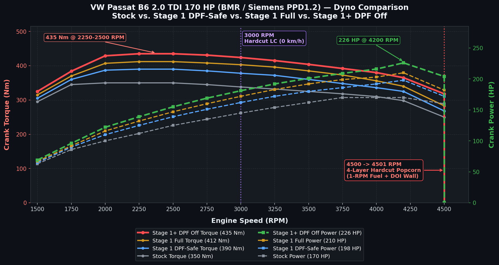

# VW Passat 2.0 TDI 170 HP (Siemens PPD1.2) — Technical Calibration, DTC, Map & Dyno Report

## 1. Vehicle & ECU Information
- **Vehicle:** VW Passat B6 2.0 TDI 16V PD (BMR) — Stock 170 HP / 350 Nm
- **ECU:** Siemens VDO PPD1.2 (`R4 2.0l PPD1.2`)
- **Software Part Number:** `03G906018EM` — Version `0420`
- **Calibration ID:** `6576286119` (`SN1K540` / `CASN1K54.DAT`)
- **File Format:** `2,097,152 bytes` (2 MB KESS v2 OBD read — active calibration region `0x40000 - 0x80000`, Big-Endian 16-bit)
- **Calibration Packages Included:**
  1. `Passat_2.0_TDI_170_Stage1_DPF_Safe_EGR.bin` — **Stage 1 DPF-Safe + EGR Off + Launch Control (2500 RPM)** *(~198 HP / 390 Nm Crank)*
  2. `Passat_2.0_TDI_170_Stage1_EGR_LC_Popcorn.bin` — **Stage 1 Full + EGR Off + Launch Control (2750 RPM) + Popcorn** *(~210 HP / 412 Nm Crank)*
  3. `Passat_2.0_TDI_170_Stage1_Plus_DPF_EGR_Off_LC_Popcorn.bin` — **Stage 1+ Max Safe + DPF Off + EGR Off + 3000 RPM Hardcut Launch Control Popcorn + 4500 RPM 4-Layer Hardcut Popcorn** *(~226 HP / 435 Nm Crank — 465 Nm Indicated)*

---

## 2. Checksum Verification (`CRC-32 MSB`)
- **Descriptor Block:** `0x402C0 - 0x402F3`
- **Checksum Location:** `0x402C4` (32-bit Big-Endian)
- **Algorithm:** Non-reflected MSB-first **CRC-32** (`poly = 0x04C11DB7`, `init = 0x00000000`, `xorout = 0x00000000`) computed across the 5 flash ranges declared at `0x402C8..0x402F3`:
  - `0x40000 - 0x402BF`
  - `0x41100 - 0x4FFFF`
  - `0x50000 - 0x5FFFF`
  - `0x60000 - 0x6FFFF`
  - `0x70000 - 0x7D87F`
- **Verification Results:**
  - Original file (`Passat_2.0_TDI_170_Stock_ORI.bin`): Calculated `0xD6BABED9` == Stored `0xD6BABED9` (**Bit-exact match**)
  - Stage 1+ file (`Passat_2.0_TDI_170_Stage1_Plus_DPF_EGR_Off_LC_Popcorn.bin`): Updated & verified `0x46DD1863` at `0x402C4`.

---

## 3. DTC Off Table (`c_err_clas = 0x00`)

Each Failure Memory entry (`fmy_id_*`) in Siemens PPD1.2 is a 28-byte record whose 25th byte (`c_err_clas`) controls error classification. Setting `c_err_clas = 0x00` disables the fault completely (no MIL, no limp mode).

### 3.1. 10 EGR DTCs (Disabled in All Tuned Files)

| # | `c_err_clas` | Record Start | Stock | New | OBD Codes | VAG Codes | A2L Symbol / Description |
| :---: | :--- | :--- | :---: | :---: | :--- | :--- | :--- |
| **1** | `0x4D307` | `0x4D2EE` | `0x93` | **`0x00`** | **P2425, P2426, P2427** | `01495`, `01496`, `09004` | `fmy_id_byp_0` — EGR Cooler Bypass Valve Circuit |
| **2** | `0x4D323` | `0x4D30A` | `0x93` | **`0x00`** | **P0401** | `01025`, `08997` | `fmy_id_egr_ctl_min` — EGR Insufficient Flow |
| **3** | `0x4D33F` | `0x4D326` | `0x93` | **`0x00`** | **P0402** | `01026`, `08999` | `fmy_id_egr_ctl_max` — EGR Excessive Flow |
| **4** | `0x4D35B` | `0x4D342` | `0xC5` | **`0x00`** | **P0401** | `05214`, `10261` | `fmy_id_maf_egr_thr_obd` — OBD EGR/Throttle Flow Low |
| **5** | `0x4D377` | `0x4D35E` | `0xC5` | **`0x00`** | **P0402** | `05215`, `10262` | `fmy_id_maf_dif_egr_thr_obd` — OBD EGR/Throttle Flow High |
| **6** | `0x4D393` | `0x4D37A` | `0x93` | **`0x00`** | **P0404, P2513** | `12592`, `09491` | `fmy_id_egrv_0_ctl` — EGR Valve (N18) Control Deviation |
| **7** | `0x4D3AF` | `0x4D396` | `0x93` | **`0x00`** | **P0404, P2514** | `12593`, `09492` | `fmy_id_v_egrv_0_bol_ad` — EGR Valve Adaptation Limit |
| **8** | `0x4D3E7` | `0x4D3CE` | `0x93` | **`0x00`** | **P0403, P0489, P0490** | `05121`, `05122`, `05184` | `fmy_id_egrv_0` — EGR Valve (N18) Electrical Circuit |
| **9** | `0x4D403` | `0x4D3EA` | `0x93` | **`0x00`** | **P0403, P1400** | `05120`, `09008` | `fmy_id_egrv` — EGR Valve H-Bridge / Open Circuit |
| **10** | `0x4E69B` | `0x4E682` | `0x93` | **`0x00`** | **P2413, P0405, P0406** | `05186`, `05187`, `09347` | `fmy_id_v_egrv_0_rng` — EGR Potentiometer (G212) Range |

### 3.2. 14 DPF, Differential Pressure (G450) & EGT Sensor DTCs (Disabled in Stage 1+ DPF Off)

| # | `c_err_clas` | Record Start | Stock | New | OBD Codes | VAG Codes | A2L Symbol / Description |
| :---: | :--- | :--- | :---: | :---: | :--- | :--- | :--- |
| **11** | `0x4D013` | `0x4CFFA` | `0xC5` | **`0x00`** | **P2002** | `08194`, `10073` | DPF Efficiency Below Threshold (Bank 1) |
| **12** | `0x4D04B` | `0x4D032` | `0x93` | **`0x00`** | **P0471** | `09299`, `10249` | `fmy_id_dip_pf_mes_es` — G450 Pressure Sensor Plausibility |
| **13** | `0x4D067` | `0x4D04E` | `0x93` | **`0x00`** | **P0471** | `01137`, `10256` | `fmy_id_dip_pf_mes_eru` — G450 Lower Offset Deviation |
| **14** | `0x4D083` | `0x4D06A` | `0x93` | **`0x00`** | **P0471** | `01137`, `10257` | `fmy_id_dip_pf_mes_grd` — G450 Upper Offset Deviation |
| **15** | `0x4D0D7` | `0x4D0BE` | `0x93` | **`0x00`** | **P2002** | `08194`, `10081` | DPF Soot / Ash Accumulation Limit Exceeded |
| **16** | `0x4D0F3` | `0x4D0DA` | `0x93` | **`0x00`** | **P0471** | `01137`, `10259` | G450 Dynamic Flow Plausibility |
| **17** | `0x4D95F` | `0x4D946` | `0xC5` | **`0x00`** | **P2002** | `08194` | OBD DPF Efficiency Fault |
| **18** | `0x4E2AB` | `0x4E292` | `0xC5` | **`0x00`** | **P2080** | `08320` | EGTS 1 (G235 Pre-Turbo) Plausibility |
| **19** | `0x4E2C7` | `0x4E2AE` | `0x93` | **`0x00`** | **P2084** | `06489` | `fmy_id_tac_mes_plaus` — EGTS 2 (G448 Pre-DPF) Plausibility |
| **20** | `0x4E2E3` | `0x4E2CA` | `0x93` | **`0x00`** | **P242B** | `09259` | EGTS 3 (G495 Post-DPF) Plausibility |
| **21** | `0x4E3FB` | `0x4E3E2` | `0xC5` | **`0x00`** | **P0545, P0546** | `01349`, `01350` | `fmy_id_v_teg_tur_up_rng` — EGTS 1 Circuit Low / High |
| **22** | `0x4E417` | `0x4E3FE` | `0x93` | **`0x00`** | **P2032, P2033** | `06487`, `06488` | `fmy_id_v_tac_rng` — EGTS 2 Circuit Low / High |
| **23** | `0x4E433` | `0x4E41A` | `0x93` | **`0x00`** | **P242C, P242D** | `05212`, `05213` | EGTS 3 Circuit Low / High |
| **24** | `0x4E647` | `0x4E62E` | `0x93` | **`0x00`** | **P0472, P0473** | `01138`, `01139`, `09344` | `fmy_id_v_dip_pf_rng` — G450 Circuit Low / High |

> All turbocharger (`P0234`/`P0299`), piezo injector, crank/cam, MAF/MAP, coolant, and fuel temperature diagnostics remain 100% enabled.

---

## 4. Calibration Map Summary (`Stage 1+`)

### 4.1. Driver Wish (`ip_fac_tq_req_dri_*`)
- **Addresses:** `0x7AAF0`, `0x7ABF0`, `0x7ACF0`, `0x7ADF0`, `0x7AEF0`, `0x7AFF0`, `0x7B120`, `0x7B340`, `0x7B6C0`, `0x7B7C0` (`16x8`, `(val - 32768) / 32.0 = Nm`)
- **Changes:** Top throttle columns (85% and 100% pedal) raised to **480 Nm** indicated torque across 1500–4500 RPM.

### 4.2. Main Torque Limiter (`ip_tqi_tql_bas @ 0x4ABE2`, Axis `0x465BC`)

| RPM | 1000 | 1250 | 1500 | 1750 | 2000 | 2250 | 2500 | 2750 | 3000 | 3250 | 3500 | 3750 | 4000 | 4200 | 4350 | 4500 | 4501 |
| :--- | :---: | :---: | :---: | :---: | :---: | :---: | :---: | :---: | :---: | :---: | :---: | :---: | :---: | :---: | :---: | :---: | :---: |
| **Stock (Nm)** | 170 | 240 | 320 | 370 | 380 | 380 | 380 | 375 | 370 | 365 | 360 | 355 | 350 | 345 | 330*(4300)* | 305 | 0*(5400)* |
| **Stage 1+ (Nm)** | 175 | 255 | 350 | 410 | **458** | **465** | **465** | **462** | **456** | **448** | **438** | **428** | **418** | **405** | **392** | **378** | **0** |

### 4.3. Secondary Torque Limiters, Torque Axes & Torque-to-Fuel (`ip_mf_bas`)
- **Gearbox Protection (`ip_tq_gb_prot @ 0x4AA3A`, `0x4AA52`, `0x4AA8A`, `0x4AAA2`):** Peak raised to **465 Nm**, and the `4500 RPM` breakpoint raised to **385–400 Nm** so no gear cuts torque early before the `4500 -> 4501 RPM` hardcut wall.
- **Atmospheric / Boiling / Fuel Temp Limiters (`0x7A8E0`, `0x7B8C0`, `0x7B9E0`, `0x7BDA8`):** Normal operating region scaled to **465 Nm** while retaining thermal protection at high coolant/fuel temperatures.
- **Torque Axes (`0x44F72..0x44FD8` & `0x46D62..0x47404`):** Top two torque breakpoints rescaled from `300 / 400 Nm` to **`375 / 470 Nm`**.
- **Torque-to-Fuel (`ip_mf_bas_0_0..1_1 @ 0x60D86 - 0x62386`, 12 maps `16x16`):** Top load columns scaled up to **75.5–76.5 mg/stk**.

### 4.4. Piezo Injector Duration (`ip_doi_main1`) & Start of Injection (`ip_soi_main1`)
- **Fuel Axis (`ldpm_mf_ip_doi_main1 @ 0x45942`):** Last two breakpoints extended from `60.0 / 70.0 mg/stk` to **`63.0 / 76.0 mg/stk`**.
- **Duration Maps (`ip_doi_main1_0..5 @ 0x5381C - 0x5421C`, 6 maps `16x16`):** Extrapolated linearly along the physical `50 -> 60 -> 70 mg/stk` piezo flow slope (~36–40 °CRK at peak fuel).
- **SOI Maps (`ip_soi_main1_0_0..1_2 @ 0x6DC8C - 0x6F48C` & `_max @ 0x7008C - 0x70C8C`, 18 maps):** Added **`+1.25° to +2.0° CRK` BTDC advance** at 2000–4500 RPM high load to keep End of Injection (EOI) and EGT safe.

### 4.5. Smoke Limiter (`ip_mf_slm_bas @ 0x6A9D6` & `_rgn @ 0x6AC36`)
- **MAF Axis (`0x467E4`):** Upper breakpoints extended to `900, 1000, 1150 mg/stk`.
- **Targets:** Up to **75.5 mg/stk** (1750–2500 RPM), **75.0 mg/stk** (3000 RPM), **74.0 mg/stk** (3500 RPM), **72.5 mg/stk** (4250 RPM), and **68.5 mg/stk** (4500 RPM), maintaining `AFR >= 15.2:1`. Mid-MAF columns at 2500–3000 RPM received `+3.0 mg/stk` transient spool enrichment for Launch Control.

### 4.6. BV43 Turbo Boost (`ip_map_sp_bas_*` & Limiters)
- **Target Boost (`0x5E98E`, `0x5EF8E` hot / `0x5EB8E`, `0x5F18E` warm):** **2690 hPa (1.69 bar gauge)** @ 2250–3000 RPM, **2680 hPa** @ 3500 RPM, **2670 hPa** @ 4000 RPM, **2600 hPa** @ 4500 RPM.
- **Limiters:** Atmospheric SVBL (`0x5FF8E`) **2750 hPa**, TIA limit (`0x6008E`) **2780 hPa**, MAP control deviation diagnostic threshold (`0x4B802`) **800 hPa**.

### 4.7. DPF Off & EGR Off Switches
- **`c_state_rgn_pf @ 0x4BC34`:** `0x0001 -> 0x0000` (disables regeneration idle/state machine).
- **`id_conf_inj_rgn_1 @ 0x475AC` & `id_conf_inj_rgn_2 @ 0x475BC`:** Replaced with normal injection profile (`id_conf_inj_0 @ 0x4757C`), disabling `POST1`/`POST2` post-injection completely.
- **MAF Setpoint Maps (`0x5C546 - 0x5D746`, all 10 normal + regen maps):** Flattened to **850 mg/stk (`0x9CA8`)**; EGR torque hysteresis curves (`0x4A8AC - 0x4A96C`, `0x4AB5C - 0x4AB96`) zeroed.

### 4.8. 3000 RPM Hardcut Launch Control & 4500 RPM 4-Layer Hardcut Popcorn
- **3000 RPM Stationary Hardcut Launch Control (`0 km/h`):**
  - `c_n_max_mt @ 0x4B980` restored to stock **`5200 RPM`** so Siemens `SUPP_AN_LIM`'s predictive PI soft-governor does not softly pull back torque prior to 3000 RPM.
  - Stationary torque limiter (`0x7B440`, `8x8`) & RPM axis (`0x42FAE`): **1-RPM razor wall (`3000 RPM = 1024 Nm` -> `3001 RPM = 0.0 Nm` at `0 km/h`)**; rolling `>= 1.8 km/h` unlocks full **`465 Nm`**.
- **4500 RPM 4-Layer Synchronized Hardcut Popcorn (All Gears):**
  1. `ip_tqi_tql_bas @ 0x4ABE2` (`0x465BC`): **`4500 RPM = 378 Nm` -> `4501 RPM = 0.0 Nm`**
  2. `ip_mf_slm_bas @ 0x6A9D6` & `_rgn @ 0x6AC36` (`0x464A6`, `0x464C8`): **`4500 RPM = 68.5 mg/stk` -> `4501 RPM = 0.0 mg/stk`** (all 19 MAF cols)
  3. `ip_mf_bas @ 0x60D86 - 0x62386` (`0x45B98`, `0x45BBA`): **`4500 RPM = 76.5 mg/stk` -> `4501 RPM = 0.0 mg/stk`** (all 16 torque cols, 12 maps)
  4. `ip_doi_main1_0..5 @ 0x5381C - 0x5421C` (`0x4611C`): **`4500 RPM = ~40.3 °CRK` -> `4501 RPM = 0.00 °CRK`** (all 16 fuel cols, 6 maps)

---

## 5. Estimated Crank Torque (Nm) & Power (HP) Curve



| RPM | Stock Torque | Stage 1 DPF-Safe | Stage 1 Full | **Stage 1+ (DPF Off)** | Stock Power | Stage 1 DPF-Safe | Stage 1 Full | **Stage 1+ (DPF Off)** |
| :---: | :---: | :---: | :---: | :---: | :---: | :---: | :---: | :---: |
| **1500** | 295 Nm | 305 Nm | 315 Nm | **325 Nm** | 63 HP | 65 HP | 67 HP | **69 HP** |
| **1750** | 345 Nm | 360 Nm | 370 Nm | **384 Nm** | 86 HP | 90 HP | 92 HP | **96 HP** |
| **2000** | 350 Nm | 387 Nm | 407 Nm | **429 Nm** | 100 HP | 110 HP | 116 HP | **122 HP** |
| **2250** | 350 Nm | 390 Nm | 412 Nm | **435 Nm** | 112 HP | 125 HP | 132 HP | **139 HP** |
| **2500** | 350 Nm | 390 Nm | 412 Nm | **435 Nm** | 125 HP | 139 HP | 147 HP | **155 HP** |
| **2750** | 345 Nm | 385 Nm | 408 Nm | **431 Nm** | 135 HP | 151 HP | 160 HP | **169 HP** |
| **3000** | 338 Nm | 378 Nm | 403 Nm | **424 Nm** | 145 HP | 162 HP | 172 HP | **181 HP** |
| **3250** | 332 Nm | 372 Nm | 396 Nm | **415 Nm** | 154 HP | 172 HP | 183 HP | **192 HP** |
| **3500** | 325 Nm | 360 Nm | 385 Nm | **404 Nm** | 162 HP | 180 HP | 192 HP | **201 HP** |
| **3750** | 318 Nm | 348 Nm | 373 Nm | **392 Nm** | 170 HP | 186 HP | 199 HP | **209 HP** |
| **4000** | 310 Nm | 336 Nm | 356 Nm | **380 Nm** | **170 HP** | 192 HP | 203 HP | **216 HP** |
| **4200** | 298 Nm | 325 Nm | 340 Nm | **365 Nm** | 170 HP | **198 HP** | **210 HP** | **226 HP** |
| **4500** | 250 Nm | 268 Nm | 283 Nm | **318 Nm** | 160 HP | 172 HP | 182 HP | **204 HP** |
| **4501** | — | — | — | **0 Nm (Hardcut)** | — | — | — | **0 HP (Popcorn)** |

### ASCII Dyno Chart — Crank Torque (Nm) & Power (HP)

```text
TORQUE (Nm)                                                             POWER (HP)
 440 Nm +------------------------------------------------------------------+ 230 HP
        |                    @ @ @ (435 Nm Stage 1+ DPF Off)     @ (226HP) |
 420 Nm |                 @         @   @                     @            | 215 HP
        |               @    * * * (412 Nm Full)           @     * (210HP) |
 400 Nm |              *   *       *   *   @            @     *     @      | 200 HP
        |             @  *   # # # (390 Nm DPF-Safe) @     *     # (198HP) |
 380 Nm |            #  #  #       #   #   *      @     *     #     *      | 180 HP
        |           *  #               #   #  @ *    *     #        #      |
 360 Nm |          #  . . . (350 Nm Stock)    #  * @    #        .  .      | 160 HP
        |         .  .     .  .  .               * #  #  .  .  .           |
 340 Nm |        .                  .  .      *  .    #            *       | 140 HP
        |       @                           . *  #   .                #    |
 320 Nm |      *                         *  #   .                        . | 120 HP
        |     #                       *  #   .                             |
 300 Nm |    .                     *  #   .                                | 100 HP
        |                       *  #   .                                   |
 280 Nm |                    *  #   .                                      | 80 HP
        +--------+-------+-------+-------+-------+-------+-------+---------+
       1500    1750    2000    2250    2500    3000    3500    4000   4500 RPM
                                                 ^LC 3000          ^HC 4501

 Legend:
   [ . ] Stock Calibration       (Peak: 350 Nm @ 2000-2500 RPM | 170 HP @ 3750-4200 RPM)
   [ # ] Stage 1 DPF-Safe        (Peak: 390 Nm Crank / 418 Nm Indicated | 198 HP @ 4200 RPM)
   [ * ] Stage 1 Full            (Peak: 412 Nm Crank / 440 Nm Indicated | 210 HP @ 4200 RPM)
   [ @ ] Stage 1+ DPF & EGR Off  (Peak: 435 Nm Crank / 465 Nm Indicated | 226 HP @ 4200 RPM | 4501 RPM Hardcut)
```
