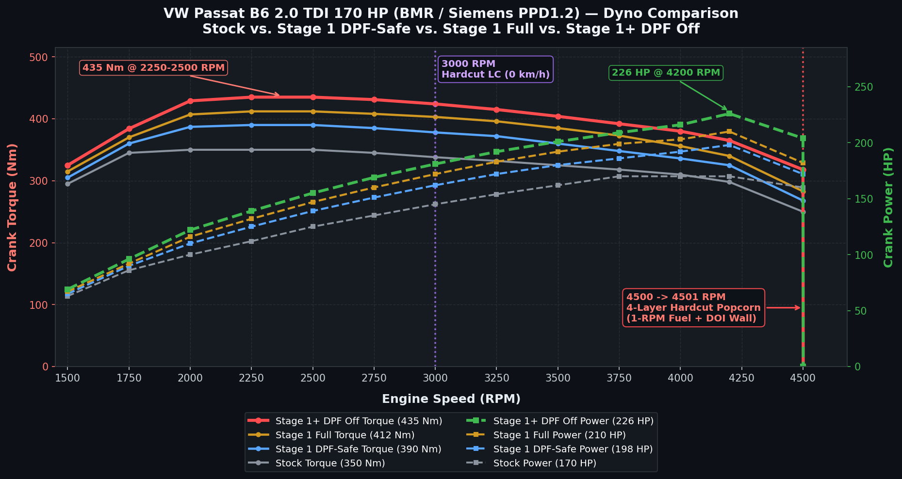

# VW Passat B6 2.0 TDI 170 HP (BMR) — Siemens VDO PPD1.2 ECU Calibration

Complete reverse-engineered calibration package, technical documentation, dyno curves, and A2L/WinOLS definitions for the **VW Passat B6 2.0 TDI 16V PD (BMR — 170 HP / 350 Nm)** equipped with a **Siemens VDO PPD1.2** ECU (`03G906018EM` v0420, Calibration ID `6576286119` / `SN1K540`).

## Highlights (`Stage 1+` Calibration)
- **Performance (~226 HP / 435 Nm Crank — 465 Nm Indicated):** Rescaled torque limiters, driver wish, torque-to-fuel (`ip_mf_bas`, up to `76.5 mg/stk`), smoke limiters (`ip_mf_slm_bas`, `AFR >= 15.2:1`), piezo injector duration axis & maps (`ip_doi_main1`, extended to `76.0 mg/stk`), SOI advance (`+1.25° to +2.0° CRK` BTDC), and BV43 turbo boost (`2690 hPa` / `1.69 bar` gauge).
- **Full DPF Off + EGR Off (24 DTCs Disabled):** Regeneration state switch (`c_state_rgn_pf @ 0x4BC34 -> 0`), post-injection disabled (`id_conf_inj_rgn_1/2 = id_conf_inj_0`), all 10 MAF setpoint maps flattened to `850 mg/stk`, EGR torque hysteresis zeroed, and 24 DPF/G450/EGTS/EGR `c_err_clas` bytes set to `0x00`.
- **3000 RPM Hardcut Launch Control Popcorn (`0 km/h`):** Soft predictive PI governor (`c_n_max_mt @ 0x4B980`) restored to stock `5200 RPM` so it does not pre-limit torque, paired with a **1-RPM razor wall (`3000 -> 3001 RPM`)** in the stationary torque limiter (`0x7B440` / `0x42FAE`) and mid-MAF neutral spool enrichment.
- **4500 RPM 4-Layer Hardcut Popcorn (All Gears):** Synchronized **1-RPM razor wall (`4500 -> 4501 RPM`)** across:
  1. Main Torque Limiter (`ip_tqi_tql_bas @ 0x4ABE2` / `0x465BC`) + Gearbox Torque Limiters (`0x4AA3A..0x4AAA2`)
  2. Smoke / Direct Fuel Mass Limiters (`ip_mf_slm_bas @ 0x6A9D6`, `_rgn @ 0x6AC36` / `0x464A6`, `0x464C8`)
  3. Torque-to-Fuel Conversion Maps (`ip_mf_bas_0_0..1_1 @ 0x60D86..0x62386` / `0x45B98`, `0x45BBA`)
  4. Piezo Injector Duration Maps (`ip_doi_main1_0..5 @ 0x5381C..0x5421C` / `0x4611C`)
- **Bit-Exact Siemens PPD1.2 Calibration Checksum:** Verified `CRC-32 MSB` (`poly = 0x04C11DB7`, `init = 0x00000000`, `xorout = 0x00000000`) at `0x402C4` across the 5 descriptor ranges declared at `0x402C8..0x402F3` (Original verified: `0xD6BABED9`, Stage 1+ verified: `0x46DD1863`).

## Dyno Comparison (Crank Torque & Power)



### RPM-by-RPM Crank Torque (Nm) & Power (HP)

| RPM | Stock Torque | Stage 1 DPF-Safe | Stage 1 Full | **Stage 1+ (DPF Off)** | Stock Power | Stage 1 DPF-Safe | Stage 1 Full | **Stage 1+ (DPF Off)** |
| :---: | :---: | :---: | :---: | :---: | :---: | :---: | :---: | :---: |
| **1500** | 295 Nm | 305 Nm | 315 Nm | **325 Nm** | 63 HP | 65 HP | 67 HP | **69 HP** |
| **1750** | 345 Nm | 360 Nm | 370 Nm | **384 Nm** | 86 HP | 90 HP | 92 HP | **96 HP** |
| **2000** | 350 Nm | 387 Nm | 407 Nm | **429 Nm** | 100 HP | 110 HP | 116 HP | **122 HP** |
| **2250** | 350 Nm | 390 Nm | 412 Nm | **435 Nm** | 112 HP | 125 HP | 132 HP | **139 HP** |
| **2500** | 350 Nm | 390 Nm | 412 Nm | **435 Nm** | 125 HP | 139 HP | 147 HP | **155 HP** |
| **2750** | 345 Nm | 385 Nm | 408 Nm | **431 Nm** | 135 HP | 151 HP | 160 HP | **169 HP** |
| **3000** | 338 Nm | 378 Nm | 403 Nm | **424 Nm** | 145 HP | 162 HP | 172 HP | **181 HP** |
| **3250** | 332 Nm | 372 Nm | 396 Nm | **415 Nm** | 154 HP | 172 HP | 183 HP | **192 HP** |
| **3500** | 325 Nm | 360 Nm | 385 Nm | **404 Nm** | 162 HP | 180 HP | 192 HP | **201 HP** |
| **3750** | 318 Nm | 348 Nm | 373 Nm | **392 Nm** | 170 HP | 186 HP | 199 HP | **209 HP** |
| **4000** | 310 Nm | 336 Nm | 356 Nm | **380 Nm** | **170 HP** | 192 HP | 203 HP | **216 HP** |
| **4200** | 298 Nm | 325 Nm | 340 Nm | **365 Nm** | 170 HP | **198 HP** | **210 HP** | **226 HP** |
| **4500** | 250 Nm | 268 Nm | 283 Nm | **318 Nm** | 160 HP | 172 HP | 182 HP | **204 HP** |
| **4501** | — | — | — | **0 Nm (Hardcut)** | — | — | — | **0 HP (Popcorn)** |

<details>
<summary>ASCII Dyno Chart (Terminal-Friendly View)</summary>

```text
TORQUE (Nm)                                                             POWER (HP)
 440 Nm +------------------------------------------------------------------+ 230 HP
        |                    @ @ @ (435 Nm Stage 1+ DPF Off)     @ (226HP) |
 420 Nm |                 @         @   @                     @            | 215 HP
        |               @    * * * (412 Nm Full)           @     * (210HP) |
 400 Nm |              *   *       *   *   @            @     *     @      | 200 HP
        |             @  *   # # # (390 Nm DPF-Safe) @     *     # (198HP) |
 380 Nm |            #  #  #       #   #   *      @     *     #     *      | 180 HP
        |           *  #               #   #  @ *    *     #        #      |
 360 Nm |          #  . . . (350 Nm Stock)    #  * @    #        .  .      | 160 HP
        |         .  .     .  .  .               * #  #  .  .  .           |
 340 Nm |        .                  .  .      *  .    #            *       | 140 HP
        |       @                           . *  #   .                #    |
 320 Nm |      *                         *  #   .                        . | 120 HP
        |     #                       *  #   .                             |
 300 Nm |    .                     *  #   .                                | 100 HP
        |                       *  #   .                                   |
 280 Nm |                    *  #   .                                      | 80 HP
        +--------+-------+-------+-------+-------+-------+-------+---------+
       1500    1750    2000    2250    2500    3000    3500    4000   4500 RPM
                                                 ^LC 3000          ^HC 4501

 Legend:
   [ . ] Stock Calibration       (Peak: 350 Nm @ 2000-2500 RPM | 170 HP @ 3750-4200 RPM)
   [ # ] Stage 1 DPF-Safe        (Peak: 390 Nm Crank / 418 Nm Indicated | 198 HP @ 4200 RPM)
   [ * ] Stage 1 Full            (Peak: 412 Nm Crank / 440 Nm Indicated | 210 HP @ 4200 RPM)
   [ @ ] Stage 1+ DPF & EGR Off  (Peak: 435 Nm Crank / 465 Nm Indicated | 226 HP @ 4200 RPM | 4501 RPM Hardcut)
```

</details>

## Repository Contents

| File | Description |
| :--- | :--- |
| `Passat_2.0_TDI_170_Stock_ORI.bin` | Original 2 MB KESS v2 OBD calibration read (`CRC-32: 0xD6BABED9`) |
| `Passat_2.0_TDI_170_Stage1_DPF_Safe_EGR.bin` | Stage 1 DPF-Safe (~198 HP / 390 Nm) + EGR Off + 2500 RPM Launch Control |
| `Passat_2.0_TDI_170_Stage1_EGR_LC_Popcorn.bin` | Stage 1 Full (~210 HP / 412 Nm) + EGR Off + Launch Control + Popcorn |
| `Passat_2.0_TDI_170_Stage1_Plus_DPF_EGR_Off_LC_Popcorn.bin` | **Stage 1+ Max Safe (~226 HP / 435 Nm) + DPF/EGR Off + 3000 RPM Hardcut LC + 4500 RPM 4-Layer Hardcut Popcorn** (`CRC-32: 0x46DD1863`) |
| `Passat_2.0_TDI_170_ECU_ID.txt` | KESS v2 ECU identification dump (`03G906018EM` v0420 / `6576286119`) |
| `Passat_2.0_TDI_170_PPD1.2_Report.md` | Full English technical report (DTC tables, map addresses, hardcut architecture, checksum, dyno curve) |
| `Passat_2.0_TDI_170_PPD1.2_Rapor.md` | Turkish technical report |
| `assets/dyno_chart.png` | Crank Torque (Nm) & Power (HP) dyno comparison chart (Stock vs. Stage 1 vs. Stage 1+) |
| `sn09103b.a2l`, `SN09503B.a2l`, `VAG_2.0_TDI_Siemens.ols` | Siemens PPD A2L / WinOLS reference files |

> **Disclaimer:** For off-road, motorsport, and educational reverse-engineering use only. Running DPF-Off calibrations requires physical DPF removal (downpipe) and must comply with local emissions regulations. Always back up your ECU before flashing.
